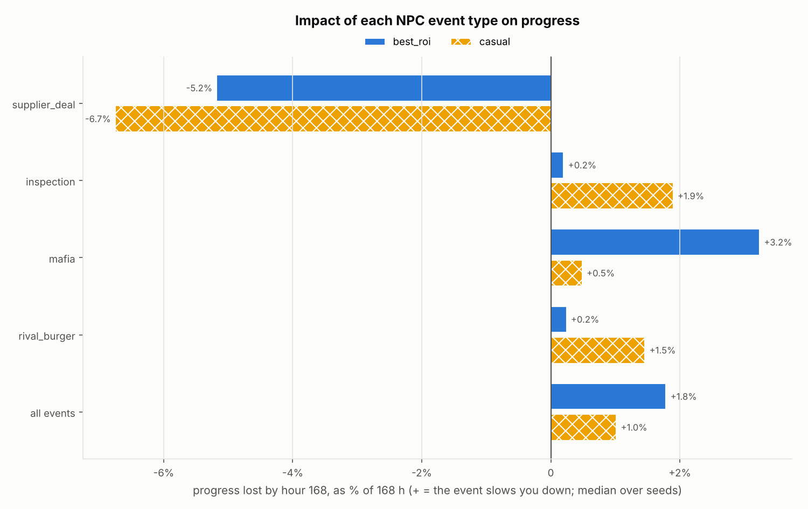

# Doner Lamar — economy balance report

Config `config/economy.yaml` (economy version 0.1.0) · seed 42 · 21 simulated days per strategy · reference strategy `best_roi`.  
Regenerate with `python -m doner_balance report`. All numbers below come from the simulation; nothing in this file is hand-written.

## What to tune first

1. **Too much play time without meaningful progress** (dead zones) — 77% of all play time of `best_roi` is spent in stretches longer than 5 min before purchases add up to +5% income (47 dead zones, 487 min in total). 42 of them fit inside a single session (*idle sessions*): the offline earnings are spent in the first seconds of a 10-minute session and the rest of the session adds almost nothing.  
   **Do:** Give the session itself something to do: raise active income relative to offline (lower `offline.efficiency` 0.5 → 0.35, or raise `tap.upgrades.showman.value` (0.01 → 0.02)), and/or add short in-session goals in the game design (NPC events while playing, timed boosts). In the economy, more mid-sized purchases per tier (a 4th staff type, more equipment levels) also break up the waits.

2. **Long wait for `franchise`** (dead zones) — On day 5.0 (stage: restaurant (run 1)) the player waits **40 min of play** (≈ 4 sessions, 29.0 h calendar) until `franchise`; meanwhile only 1 small purchase (mostly `night_shift`).  
   **Do:** Wall before **franchise**. Keep the pacing target and fill the gap with content in the `restaurant` tier: e.g. a 4th staff item with `base_cost` ≈ 12T and `income` ≈ 380M (base payback ~1.6x the last staff), or more levels on `interior` (`max_level` +5). Lowering `tiers.franchise.unlock_cost` also helps but moves the franchise milestone earlier.

3. **Long wait for `marketing_dept`** (dead zones) — On day 9.0 (stage: franchise (run 1)) the player waits **30 min of play** (≈ 3 sessions, 24.0 h calendar) until `marketing_dept`; meanwhile only 0 small purchases.  
   **Do:** Reduce `cost_growth` of `marketing_dept` by 0.01, or add a cheaper intermediate upgrade in stage franchise (run 1).

## Current balance at a glance

- **Milestones (`best_roi`):** first_upgrade 4 s, first_manager 1.8 min, cafe 8.5 min, restaurant 24.0 h, franchise 6.2 d, first_prestige 12.4 d (calendar time since install).
- **Stage lengths (run 1):** kiosk 8.5 min (9 min play), cafe 23.9 h (21 min play), restaurant 5.2 d (160 min play), franchise 6.2 d (190 min play).
- **Income while playing:** end of day 1 117K/s, end of day 3 34.4M/s, end of day 7 10.1B/s, end of day 14 10.1M/s (resets after each prestige).
- **Where coins come from (day 2+):** taps 2.9%, automation while playing 7.7%, offline 89.4%.
- **Dead zones:** 47 waits > 5 min of play, 77% of all play time, longest 40 min.
- **Pacing targets met:** 5/5.
- **Localization:** 52 player-facing texts in `en`; no other languages configured (`localization.languages`).
- **Prestiges in 21 days:** 1, reputation 54 (x2.08 income).

## 1. Milestones per strategy

Calendar time since install (play time in brackets). Strategies:

- `best_roi` — Buys the item with the shortest payback (cost / income gain), saving for it if needed. Profile `regular`: 3×10 min/day, 2.5 taps/s on average, smart NPC answers.
- `cheapest` — Always buys the cheapest item that increases income. Profile `regular`: 3×10 min/day, 2.5 taps/s on average, smart NPC answers.
- `saver` — Saves for the next tier whenever it is within reach, otherwise best ROI. Profile `regular`: 3×10 min/day, 2.5 taps/s on average, smart NPC answers.
- `casual` — Best ROI, but only 2 short sessions per day, little tapping, default event answers. Profile `casual`: 2×5 min/day, 0.9 taps/s on average, default NPC answers.

| strategy | first_upgrade | first_manager | cafe | restaurant | franchise | first_prestige |
|---|---|---|---|---|---|---|
| best_roi | 4 s (4 s) | 1.8 min (1.8 min) | 8.5 min (8.5 min) | 24.0 h (30.0 min) | 6.2 d (3.2 h) | 12.4 d (6.3 h) |
| cheapest | 4 s (4 s) | 6.8 min (6.8 min) | 5.0 h (10.0 min) | 2.0 d (1.0 h) | — | — |
| saver | 4 s (4 s) | 1.8 min (1.8 min) | 5.8 min (5.8 min) | 10.0 h (20.0 min) | 6.2 d (3.2 h) | 12.4 d (6.3 h) |
| casual | 12 s (12 s) | 4.0 min (4.0 min) | 6.6 h (8.4 min) | 2.0 d (20.0 min) | 11.0 d (1.8 h) | 20.0 d (3.3 h) |

## 2. Pacing vs targets

Targets live in `pacing.targets` of the config and are checked against `best_roi`. Calendar targets are judged on the equivalent play time (sessions quantize calendar time). The suggestion column comes from re-simulating with the lever scaled and measuring the elasticity.

| milestone | target | actual | status | lever | lever value | suggestion |
|---|---|---|---|---|---|---|
| first_upgrade | 30 s active (at_most) | 4 s | ✅ ok | `tap.upgrades.knife.base_cost` | 10 | — |
| cafe | 8.0 min active (around) | 8.5 min | ✅ ok | `tier:cafe` | 30K | — |
| restaurant | 24.0 h calendar (around) | 24.0 h (30.0 min play) | ✅ ok | `tier:restaurant` | 43M | — |
| franchise | 7.0 d calendar (around) | 6.2 d (3.2 h play) | ✅ ok | `tier:franchise` | 57T | — |
| first_prestige | 14.0 d calendar (around) | 12.4 d (6.3 h play) | ✅ ok | `prestige.base_requirement` | 7.70e+15 | — |

`python -m doner_balance tune` prints this table; `tune --apply` searches all levers sequentially and writes an overrides file.

## 3. Dead zones

A *dead zone* is a stretch of **play time** longer than `analysis.dead_zone_threshold_active_minutes` = 5 min in which the player's purchases do not add up to *meaningful progress*: +5% income in total, a new tier or a prestige. Offline time does not count.

| strategy | dead_zones | total_dead_min | share_of_play_pct | longest_min | longest_starts_day |
|---|---|---|---|---|---|
| best_roi | 47 | 487 | 77% | 40 | 5.0 |
| cheapest | 48 | 558 | 89% | 40 | 15.4 |
| saver | 49 | 505 | 80% | 40 | 5.0 |
| casual | 15 | 95 | 45% | 15 | 9.3 |

Longest dead zones for `best_roi`:

| start_day | gap_active_min | gap_calendar_h | stage | ended_by | small_buys | most_bought |
|---|---|---|---|---|---|---|
| 5.0 | 40 min | 29.0 h | restaurant (run 1) | franchise | 1 | night_shift |
| 9.0 | 30 min | 24.0 h | franchise (run 1) | marketing_dept | 0 |  |
| 7.2 | 20 min | 19.0 h | franchise (run 1) | regional_director | 0 |  |
| 15.4 | 20 min | 19.0 h | restaurant (run 2) | franchise | 0 |  |
| 17.4 | 13 min | 18.9 h | franchise (run 2) | marketing_dept | 1 | franchisee |
| 16.2 | 10 min | 5.0 h | restaurant (run 2) | franchisee | 0 |  |
| 18.2 | 10 min | 5.0 h | franchise (run 2) | marketing_dept | 0 |  |
| 19.2 | 10 min | 5.0 h | franchise (run 2) | marketing_dept | 0 |  |

The payback chart shows how long each purchase takes to pay for itself in real time. A healthy idle curve rises slowly and steadily; flat clouds far above the rest are walls.

## 4. Income over time and its sources

Share of coins earned from day 2 on:

| strategy | taps | automation (playing) | offline | taps share of active income | final active income/s |
|---|---|---|---|---|---|
| best_roi | 2.9% | 7.7% | 89.4% | 27% | 45.4T |
| cheapest | 2.6% | 6.9% | 90.5% | 27% | 2.87B |
| saver | 2.9% | 7.6% | 89.5% | 27% | 47.7T |
| casual | 0.3% | 2.1% | 97.6% | 12% | 17.8K |

## 5. NPC events

Ablation study over 5 seeds: each event type is switched off on its own and the run is compared with the run where it is on. Every event type has its own random stream, so switching one off does not change the others.

- **shift** — hours of progress the event costs by hour 168: the run without the event reached the same all-time earnings that much earlier (negative = the event speeds you up). **delay %** = shift / 168 h. This is the headline number.
- **franchise play** — extra play time to reach the franchise (coarse: purchases happen in sessions).
- **earnings** — all-time earnings at hour 168 with vs without (noisy: earnings grow exponentially).
- **net** — direct accounting (bonus income − lost income − answer costs − cash losses) / final earnings.

| strategy | event | fired/run | shift | delay % | franchise play | earnings | net |
|---|---|---|---|---|---|---|---|
| best_roi | supplier_deal | 26.4 | -8.7 h | -5.2% | -10 min | +37.0% | +5.5% |
| best_roi | inspection | 14.0 | +0.3 h | +0.2% | +0 min | -1.8% | -1.3% |
| best_roi | mafia | 8.0 | +5.4 h | +3.2% | +0 min | -27.0% | -1.1% |
| best_roi | rival_burger | 5.6 | +0.4 h | +0.2% | +0 min | -2.3% | -1.7% |
| best_roi | all events | — | +3.0 h | +1.8% | +0 min | -16.5% | — |
| casual | supplier_deal | 24.4 | -11.3 h | -6.7% | -10 min | +104.4% | +4.4% |
| casual | inspection | 13.2 | +3.2 h | +1.9% | +0 min | -15.1% | -4.4% |
| casual | mafia | 8.0 | +0.8 h | +0.5% | +0 min | -4.5% | -4.0% |
| casual | rival_burger | 5.2 | +2.5 h | +1.5% | +0 min | -16.8% | -4.3% |
| casual | all events | — | +1.7 h | +1.0% | +0 min | -10.2% | — |

Answers chosen (main runs):

| event | response | best_roi | casual | cheapest | saver |
|---|---|---|---|---|---|
| inspection | pay_fine | 11 | 13 | 14 | 11 |
| inspection | renovate | 3 | 0 | 0 | 3 |
| mafia | pay | 6 | 8 | 6 | 6 |
| mafia | police | 3 | 0 | 2 | 2 |
| rival_burger | ignore | 0 | 6 | 0 | 0 |
| rival_burger | promo | 6 | 0 | 6 | 6 |
| supplier_deal | accept | 29 | 27 | 28 | 29 |
| supplier_deal | decline | 0 | 0 | 1 | 0 |

## 6. Prestige runs

Hours after the start of each run (a run starts at install or at a prestige reset). Selling the empire needs `franchise` and gives `floor(10 * (all_time / 7.70e+15) ^ 0.5)` reputation, +2% income each.

| strategy | run | start_h | cafe_after_h | restaurant_after_h | franchise_after_h | prestige_after_h | reputation_gained |
|---|---|---|---|---|---|---|---|
| best_roi | 1 | 0 s | 8.5 min | 24.0 h | 6.2 d | 12.4 d | 54 |
| best_roi | 2 | 12.4 d | 4.1 min | 14.1 h | 3.8 d | — | 0 |
| cheapest | 1 | 0 s | 5.0 h | 2.0 d | — | — | 0 |
| saver | 1 | 0 s | 5.8 min | 10.0 h | 6.2 d | 12.4 d | 54 |
| saver | 2 | 12.4 d | 2.6 min | 14.0 h | 3.8 d | — | 0 |
| casual | 1 | 0 s | 6.6 h | 2.0 d | 11.0 d | 20.0 d | 58 |
| casual | 2 | 20.0 d | 6.5 h | — | — | — | 0 |

## 7. All findings and recommendations

Sorted by severity (0–100). Rules live in `doner_balance/recommend.py`; thresholds in `analysis:` of the config.

- **[80] Too much play time without meaningful progress** (dead zones)  
  77% of all play time of `best_roi` is spent in stretches longer than 5 min before purchases add up to +5% income (47 dead zones, 487 min in total). 42 of them fit inside a single session (*idle sessions*): the offline earnings are spent in the first seconds of a 10-minute session and the rest of the session adds almost nothing.  
  → Give the session itself something to do: raise active income relative to offline (lower `offline.efficiency` 0.5 → 0.35, or raise `tap.upgrades.showman.value` (0.01 → 0.02)), and/or add short in-session goals in the game design (NPC events while playing, timed boosts). In the economy, more mid-sized purchases per tier (a 4th staff type, more equipment levels) also break up the waits.
- **[53] Long wait for `franchise`** (dead zones)  
  On day 5.0 (stage: restaurant (run 1)) the player waits **40 min of play** (≈ 4 sessions, 29.0 h calendar) until `franchise`; meanwhile only 1 small purchase (mostly `night_shift`).  
  → Wall before **franchise**. Keep the pacing target and fill the gap with content in the `restaurant` tier: e.g. a 4th staff item with `base_cost` ≈ 12T and `income` ≈ 380M (base payback ~1.6x the last staff), or more levels on `interior` (`max_level` +5). Lowering `tiers.franchise.unlock_cost` also helps but moves the franchise milestone earlier.
- **[51] Long wait for `marketing_dept`** (dead zones)  
  On day 9.0 (stage: franchise (run 1)) the player waits **30 min of play** (≈ 3 sessions, 24.0 h calendar) until `marketing_dept`; meanwhile only 0 small purchases.  
  → Reduce `cost_growth` of `marketing_dept` by 0.01, or add a cheaper intermediate upgrade in stage franchise (run 1).
- **[49] Long wait for `regional_director`** (dead zones)  
  On day 7.2 (stage: franchise (run 1)) the player waits **20 min of play** (≈ 2 sessions, 19.0 h calendar) until `regional_director`; meanwhile only 0 small purchases.  
  → Reduce `cost_growth` of `regional_director` by 0.01, or add a cheaper intermediate upgrade in stage franchise (run 1).
- **[44] Offline earnings dominate** (offline)  
  From day 2 on, 89% of `best_roi`'s coins come from offline earnings; the 10-minute sessions add little beyond spending.  
  → Fine for a relaxed idle game. If sessions should matter more, lower `offline.efficiency` (0.5 → 0.35) or reduce manager `offline_cap_hours_add`, and re-run `tune` (pacing will slow down).
- **[35] `cheapest` stalls before cafe** (strategies)  
  `cheapest` reaches `cafe` after 5.0 h vs 8.5 min for `best_roi` (same sessions, different buying).  
  → Players who buy naively get stuck: show a 'best buy' hint in the UI, and/or steepen `cost_growth` of the cheapest generators (e.g. `nephew` 1.12 → 1.14) so cheap items stop soaking up cash.
- **[25] Saving for cafe beats greedy ROI** (strategies)  
  `saver` reaches `cafe` after 5.8 min vs 8.5 min for `best_roi`.  
  → The cafe unlock is worth more than its immediate income gain suggests (its global multiplier and new items). Fine as a skill expression; if unwanted, lower `tiers.cafe.global_income_mult`.
- **[12] Sanitary inspection barely matters for `best_roi`** (events)  
  Effect on progress: +0.3 h by hour 168 (+0.2%).  
  → If the inspector should be a memorable NPC, raise stakes (rate 0.04/h or effect size); otherwise it is flavour.
- **[12] Rival burger joint opens nearby barely matters for `best_roi`** (events)  
  Effect on progress: +0.4 h by hour 168 (+0.2%).  
  → If the rival should be a memorable NPC, raise stakes (rate 0.02/h or effect size); otherwise it is flavour.
- **[12] Mafia "protection" visit barely matters for `casual`** (events)  
  Effect on progress: +0.8 h by hour 168 (+0.5%).  
  → If the mafia should be a memorable NPC, raise stakes (rate 0.03/h or effect size); otherwise it is flavour.
- **[10] Tap share is healthy** (taps)  
  After day 1 taps make 27% of the income earned while playing (2.9% of all income incl. offline).  
  → No change needed.
- **[10] Prestige loop works** (prestige)  
  Run 2 reaches franchise x1.6 faster than run 1 (x2.08 income from 54 reputation).  
  → No change needed.
- **[8] `casual` pace is acceptable** (casual)  
  `casual` reaches `franchise` after 11.0 d vs 6.2 d (x1.8, warning above x3).  
  → No change needed.

## Summary

**Pacing.** 5 of 5 pacing targets are met for `best_roi` (first_upgrade at 4 s, cafe at 8.5 min, restaurant at 24.0 h, franchise at 6.2 d, first_prestige at 12.4 d).

**Shape.** The first run is kiosk → cafe → restaurant → franchise; the longest stage is **franchise** (6.2 d, 190 min of play).

**Income.** From day 2 on, 89% of coins come from offline earnings, 8% from automation while playing and 3% from taps (taps are 27% of what is earned during a session).

**Dead zones.** 77% of play time passes without +5% progress; the longest wait is 40 min of play.

**Other players.** Time to franchise: `best_roi` 6.2 d, `cheapest` never, `saver` 6.2 d, `casual` 11.0 d.

**NPCs.** All events together shift `best_roi` by +3.0 h by hour 168; the strongest single NPC is `supplier_deal` (-8.7 h).

**Tune first:** (1) Too much play time without meaningful progress. (2) Long wait for `franchise`. (3) Long wait for `marketing_dept`. Details and concrete values are at the top of this report.

## Files

| file | content |
|---|---|
| `milestones.csv` | time to every milestone per strategy (calendar h, play min) |
| `pacing_targets.csv` | targets, actual values, lever, elasticity, suggestion |
| `dead_zones.csv / dead_zone_summary.csv` | every dead zone and per-strategy totals |
| `income_sources.csv` | coins per day from taps / automation / offline |
| `stage_lengths.csv` | time spent per tier in run 1 |
| `prestige_runs.csv` | tier times inside each prestige run |
| `event_impact.csv / event_impact_runs.csv` | NPC ablation summary and raw runs |
| `event_responses.csv, events_<strategy>.csv` | NPC answers chosen and full event logs |
| `purchases_<strategy>.csv` | every purchase with cost, income gain and payback |
| `timeseries_<strategy>.csv` | state every 30 min: cash, incomes, tier, reputation |
| `recommendations.csv` | the findings above as a table |
| `export/economy.json` | Godot export of this config (see `docs/GODOT_EXPORT.md`) |

_Generated in 22 s._
