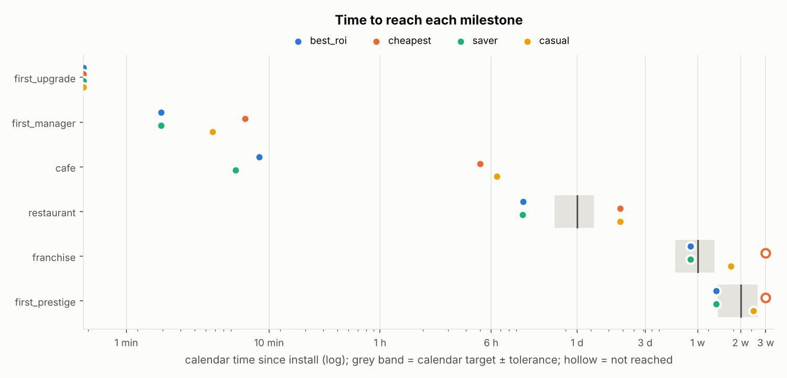
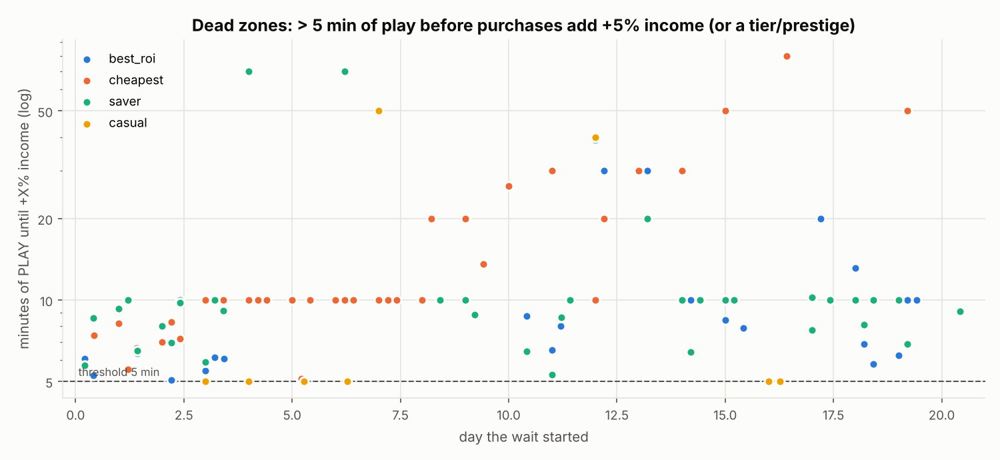
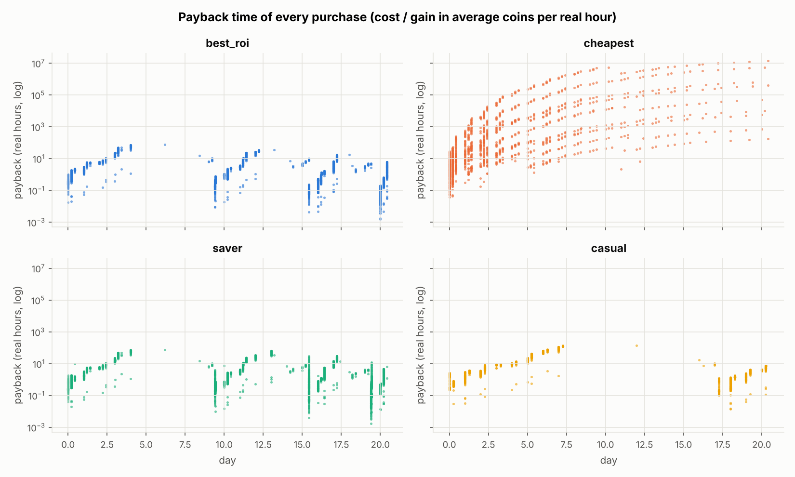
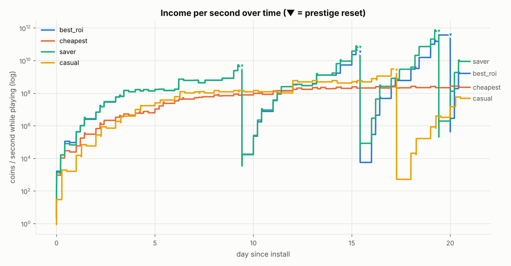
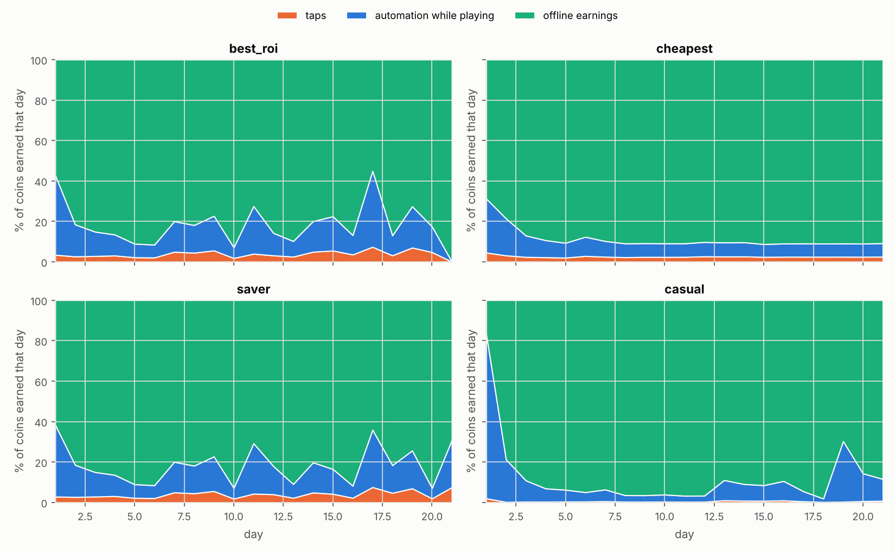

# Doner Lamar — economy balance report

Config `config/economy.yaml` (economy version 0.1.0) · seed 42 · 21 simulated days per strategy · reference strategy `best_roi`.  
Regenerate with `python -m doner_balance report`. All numbers below come from the simulation; nothing in this file is hand-written.

## What to tune first

1. **Too much play time without meaningful progress** (dead zones) — 72% of all play time of `best_roi` is spent in stretches longer than 5 min before purchases add up to +5% income (33 dead zones, 451 min in total). 27 of them fit inside a single session (*idle sessions*): the offline earnings are spent in the first seconds of a 10-minute session and the rest of the session adds almost nothing.  
   **Do:** Give the session itself something to do: raise active income relative to offline (lower `offline.efficiency` 0.5 → 0.35, or raise `tap.upgrades.showman.value`), and/or add short in-session goals in the game design (NPC events while playing, timed boosts). In the economy, more mid-sized purchases per tier (a 4th staff type, more equipment levels) also break up the waits.

2. **Long wait for `coo`** (dead zones) — On day 6.2 (stage: restaurant (run 1)) the player waits **70 min of play** (≈ 7 sessions, 2.2 d calendar) until `coo`; meanwhile only 0 small purchases.  
   **Do:** The manager `coo` is too expensive right after its tier opens (the tier earns nothing offline until then). Lower `tiers.franchise.managers.coo.cost`: 10T → **1.4T**.

3. **Long wait for `franchise`** (dead zones) — On day 4.0 (stage: restaurant (run 1)) the player waits **70 min of play** (≈ 7 sessions, 2.2 d calendar) until `franchise`; meanwhile only 2 small purchases (mostly `head_chef`).  
   **Do:** Wall before **franchise**. Keep the pacing target and fill the gap with content in the `restaurant` tier: e.g. a 4th staff item with `base_cost` ≈ 5.3B and `income` ≈ 280K (base payback ~1.6x the last staff), or more levels on `interior` (`max_level` +5). Lowering `tiers.franchise.unlock_cost` also helps but moves the franchise milestone earlier.

## Current balance at a glance

- **Milestones (`best_roi`):** first_upgrade 4 s, first_manager 1.8 min, cafe 8.5 min, restaurant 10.1 h, franchise 6.2 d, first_prestige 9.4 d (calendar time since install).
- **Stage lengths (run 1):** kiosk 8.5 min (9 min play), cafe 9.9 h (17 min play), restaurant 5.8 d (165 min play), franchise 3.2 d (100 min play).
- **Income while playing:** end of day 1 114K/s, day 3 29.1M/s, day 7 740M/s, day 14 1.31B/s (resets after each prestige).
- **Where coins come from (day 2+):** taps 1.8%, automation while playing 4.9%, offline 93.3%.
- **Dead zones:** 33 waits > 5 min of play, 72% of all play time, longest 70 min.
- **Pacing targets met:** 4/5.
- **Prestiges in 21 days:** 3, reputation 525 (x11.50 income).

## 1. Milestones per strategy

Calendar time since install (play time in brackets). Strategies:

- `best_roi` — Buys the item with the shortest payback (cost / income gain), saving for it if needed. Profile `regular`: 3×10 min/day, 2.5 taps/s on average, smart NPC answers.
- `cheapest` — Always buys the cheapest item that increases income. Profile `regular`: 3×10 min/day, 2.5 taps/s on average, smart NPC answers.
- `saver` — Saves for the next tier whenever it is within reach, otherwise best ROI. Profile `regular`: 3×10 min/day, 2.5 taps/s on average, smart NPC answers.
- `casual` — Best ROI, but only 2 short sessions per day, little tapping, default event answers. Profile `casual`: 2×5 min/day, 0.9 taps/s on average, default NPC answers.

| strategy | first_upgrade | first_manager | cafe | restaurant | franchise | first_prestige |
|---|---|---|---|---|---|---|
| best_roi | 4 s (4 s) | 1.8 min (1.8 min) | 8.5 min (8.5 min) | 10.1 h (25.3 min) | 6.2 d (3.2 h) | 9.4 d (4.8 h) |
| cheapest | 4 s (4 s) | 6.8 min (6.8 min) | 5.0 h (10.0 min) | 2.0 d (1.0 h) | — | — |
| saver | 4 s (4 s) | 1.8 min (1.8 min) | 5.8 min (5.8 min) | 10.0 h (20.0 min) | 6.2 d (3.2 h) | 9.4 d (4.8 h) |
| casual | 12 s (12 s) | 4.0 min (4.0 min) | 6.6 h (8.4 min) | 2.0 d (20.0 min) | 12.0 d (2.0 h) | 17.3 d (2.9 h) |

## 2. Pacing vs targets

Targets live in `pacing.targets` of the config and are checked against `best_roi`. Calendar targets are judged on the equivalent play time (sessions quantize calendar time). The suggestion column comes from re-simulating with the lever scaled and measuring the elasticity.

| milestone | target | actual | status | lever | lever value | suggestion |
|---|---|---|---|---|---|---|
| first_upgrade | 30 s active (at_most) | 4 s | ✅ ok | `tap.upgrades.knife.base_cost` | 10 | — |
| cafe | 8.0 min active (around) | 8.5 min | ✅ ok | `tier:cafe` | 30K | — |
| restaurant | 24.0 h calendar (around) | 10.1 h (25.3 min play) | ✅ ok | `tier:restaurant` | 30M | — |
| franchise | 7.0 d calendar (around) | 6.2 d (3.2 h play) | ✅ ok | `tier:franchise` | 7T | — |
| first_prestige | 14.0 d calendar (around) | 9.4 d (4.8 h play) | ⚠️ too fast | `prestige.base_requirement` | 2.7T | — |

`python -m doner_balance tune` prints this table; `tune --apply` searches all levers sequentially and writes an overrides file.

## 3. Dead zones

A *dead zone* is a stretch of **play time** longer than `analysis.dead_zone_threshold_active_minutes` = 5 min in which the player's purchases do not add up to *meaningful progress*: +5% income in total, a new tier or a prestige. Offline time does not count.

| strategy | dead_zones | total_dead_min | share_of_play_pct | longest_min | longest_starts_day |
|---|---|---|---|---|---|
| best_roi | 33 | 451 | 72% | 70 | 4.0 |
| cheapest | 35 | 585 | 93% | 80 | 16.4 |
| saver | 36 | 477 | 76% | 70 | 4.0 |
| casual | 8 | 120 | 57% | 50 | 7.0 |

Longest dead zones for `best_roi`:

| start_day | gap_active_min | gap_calendar_h | stage | ended_by | small_buys | most_bought |
|---|---|---|---|---|---|---|
| 6.2 | 70 min | 2.2 d | restaurant (run 1) | coo | 0 |  |
| 4.0 | 70 min | 2.2 d | restaurant (run 1) | franchise | 2 | head_chef |
| 12.2 | 30 min | 24.0 h | restaurant (run 2) | franchise | 0 |  |
| 13.2 | 30 min | 24.0 h | restaurant (run 2) | coo | 0 |  |
| 17.2 | 20 min | 19.0 h | restaurant (run 3) | franchise | 0 |  |
| 18.0 | 13 min | 5.1 h | restaurant (run 3) | coo | 0 |  |
| 19.2 | 10 min | 5.0 h | franchise (run 3) | marketing_dept | 0 |  |
| 11.4 | 10 min | 14.0 h | restaurant (run 2) | catering | 0 |  |

The payback chart shows how long each purchase takes to pay for itself in real time. A healthy idle curve rises slowly and steadily; flat clouds far above the rest are walls.

## 4. Income over time and its sources

Share of coins earned from day 2 on:

| strategy | taps | automation (playing) | offline | taps share of active income | final active income/s |
|---|---|---|---|---|---|
| best_roi | 1.8% | 4.9% | 93.3% | 27% | 1.66B |
| cheapest | 2.5% | 6.7% | 90.8% | 27% | 234M |
| saver | 2.2% | 5.8% | 92.1% | 27% | 9.36B |
| casual | 0.4% | 3.5% | 96.2% | 9% | 49.3M |

## 5. NPC events

Answers chosen (main runs):

| event | response | best_roi | casual | cheapest | saver |
|---|---|---|---|---|---|
| inspection | pay_fine | 11 | 13 | 14 | 11 |
| inspection | renovate | 3 | 0 | 0 | 3 |
| mafia | pay | 6 | 9 | 8 | 3 |
| mafia | police | 2 | 0 | 0 | 4 |
| rival_burger | ignore | 0 | 6 | 0 | 0 |
| rival_burger | promo | 5 | 0 | 6 | 6 |
| supplier_deal | accept | 26 | 27 | 28 | 26 |
| supplier_deal | decline | 3 | 0 | 1 | 3 |

## 6. Prestige runs

Hours after the start of each run (a run starts at install or at a prestige reset). Selling the empire needs `franchise` and gives `floor(10 * (all_time / 2.7T) ^ 0.5)` reputation, +2% income each.

| strategy | run | start_h | cafe_after_h | restaurant_after_h | franchise_after_h | prestige_after_h | reputation_gained |
|---|---|---|---|---|---|---|---|
| best_roi | 1 | 0 s | 8.5 min | 10.1 h | 6.2 d | 9.4 d | 56 |
| best_roi | 2 | 9.4 d | 4.0 min | 14.1 h | 3.8 d | 6.0 d | 106 |
| best_roi | 3 | 15.4 d | 2.1 min | 18.9 h | 2.6 d | 4.6 d | 363 |
| best_roi | 4 | 20.0 d | 47 s | 6.9 min | — | — | 0 |
| cheapest | 1 | 0 s | 5.0 h | 2.0 d | — | — | 0 |
| saver | 1 | 0 s | 5.8 min | 10.0 h | 6.2 d | 9.4 d | 56 |
| saver | 2 | 9.4 d | 2.6 min | 14.0 h | 3.8 d | 6.0 d | 141 |
| saver | 3 | 15.4 d | 1.2 min | 14.0 h | 2.0 d | 4.0 d | 355 |
| saver | 4 | 19.4 d | 31 s | 6.3 min | 24.0 h | — | 0 |
| casual | 1 | 0 s | 6.6 h | 2.0 d | 12.0 d | 17.3 d | 56 |
| casual | 2 | 17.3 d | 17.5 h | 24.0 h | — | — | 0 |

## 7. All findings and recommendations

Sorted by severity (0–100). Rules live in `doner_balance/recommend.py`; thresholds in `analysis:` of the config.

- **[80] Too much play time without meaningful progress** (dead zones)  
  72% of all play time of `best_roi` is spent in stretches longer than 5 min before purchases add up to +5% income (33 dead zones, 451 min in total). 27 of them fit inside a single session (*idle sessions*): the offline earnings are spent in the first seconds of a 10-minute session and the rest of the session adds almost nothing.  
  → Give the session itself something to do: raise active income relative to offline (lower `offline.efficiency` 0.5 → 0.35, or raise `tap.upgrades.showman.value`), and/or add short in-session goals in the game design (NPC events while playing, timed boosts). In the economy, more mid-sized purchases per tier (a 4th staff type, more equipment levels) also break up the waits.
- **[59] Long wait for `coo`** (dead zones)  
  On day 6.2 (stage: restaurant (run 1)) the player waits **70 min of play** (≈ 7 sessions, 2.2 d calendar) until `coo`; meanwhile only 0 small purchases.  
  → The manager `coo` is too expensive right after its tier opens (the tier earns nothing offline until then). Lower `tiers.franchise.managers.coo.cost`: 10T → **1.4T**.
- **[59] Long wait for `franchise`** (dead zones)  
  On day 4.0 (stage: restaurant (run 1)) the player waits **70 min of play** (≈ 7 sessions, 2.2 d calendar) until `franchise`; meanwhile only 2 small purchases (mostly `head_chef`).  
  → Wall before **franchise**. Keep the pacing target and fill the gap with content in the `restaurant` tier: e.g. a 4th staff item with `base_cost` ≈ 5.3B and `income` ≈ 280K (base payback ~1.6x the last staff), or more levels on `interior` (`max_level` +5). Lowering `tiers.franchise.unlock_cost` also helps but moves the franchise milestone earlier.
- **[56] The restaurant stage carries 61% of the journey** (content)  
  In run 1 the player spends 5.8 d (165 min of play) in restaurant with 3 staff, 2 upgrades and 1 manager(s) to buy.  
  → Either add content to `restaurant` (another staff type and 1-2 upgrades), or move the stage boundary: lower the next tier's cost and raise the target accordingly.
- **[50] first_prestige is too fast** (pacing)  
  `first_prestige` (first prestige in about two weeks): reached after 4.8 h of play / 9.4 d calendar; target 7.0 h of play (= 14.0 d calendar). Status: **too fast** (x0.69).  
  → Lever has no measurable effect; adjust the previous stage instead.
- **[48] Offline earnings dominate** (offline)  
  From day 2 on, 93% of `best_roi`'s coins come from offline earnings; the 10-minute sessions add little beyond spending.  
  → Fine for a relaxed idle game. If sessions should matter more, lower `offline.efficiency` (0.5 → 0.35) or reduce manager `offline_cap_hours_add`, and re-run `tune` (pacing will slow down).
- **[35] `cheapest` stalls before cafe** (strategies)  
  `cheapest` reaches `cafe` after 5.0 h vs 8.5 min for `best_roi` (same sessions, different buying).  
  → Players who buy naively get stuck: show a 'best buy' hint in the UI, and/or steepen `cost_growth` of the cheapest generators (e.g. `nephew` 1.12 → 1.14) so cheap items stop soaking up cash.
- **[25] Saving for cafe beats greedy ROI** (strategies)  
  `saver` reaches `cafe` after 5.8 min vs 8.5 min for `best_roi`.  
  → The cafe unlock is worth more than its immediate income gain suggests (its global multiplier and new items). Fine as a skill expression; if unwanted, lower `tiers.cafe.global_income_mult`.
- **[10] Tap share is healthy** (taps)  
  After day 1 taps make 27% of the income earned while playing (1.8% of all income incl. offline).  
  → No change needed.
- **[10] Prestige loop works** (prestige)  
  Run 2 reaches franchise x1.6 faster than run 1 (x2.12 income from 56 reputation).  
  → No change needed.
- **[8] `casual` pace is acceptable** (casual)  
  `casual` reaches `franchise` after 12.0 d vs 6.2 d (x1.9, warning above x3).  
  → No change needed.

## Files

| file | content |
|---|---|
| `milestones.csv` | time to every milestone per strategy (calendar h, play min) |
| `pacing_targets.csv` | targets, actual values, lever, elasticity, suggestion |
| `dead_zones.csv / dead_zone_summary.csv` | every dead zone and per-strategy totals |
| `income_sources.csv` | coins per day from taps / automation / offline |
| `stage_lengths.csv` | time spent per tier in run 1 |
| `prestige_runs.csv` | tier times inside each prestige run |
| `event_impact.csv / event_impact_runs.csv` | NPC ablation summary and raw runs |
| `event_responses.csv, events_<strategy>.csv` | NPC answers chosen and full event logs |
| `purchases_<strategy>.csv` | every purchase with cost, income gain and payback |
| `timeseries_<strategy>.csv` | state every 30 min: cash, incomes, tier, reputation |
| `recommendations.csv` | the findings above as a table |
| `export/economy.json` | Godot export of this config (see `docs/GODOT_EXPORT.md`) |

_Generated in 7 s._
